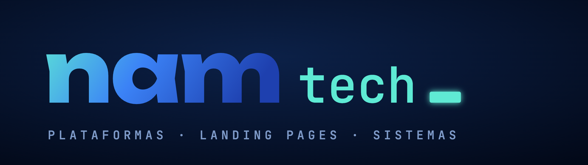

# Agentes da NAM Tech

Seis agentes de IA para o Claude Code que fazem parte do dia a dia da NAM Tech: pesquisa, escrita de prompt,
crítica, segurança, briefing diário e carreira. Cada agente é um arquivo Markdown com as regras, o método de
trabalho e o formato de entrega.

## Os agentes

| Agente | Papel | Modelo |
|---|---|---|
| [Argos](agentes/argos.md) | Pesquisa referências, técnicas e ferramentas para uma ideia e entrega um dossiê curto com fontes | herda da sessão |
| [Apolo](agentes/apolo.md) | Transforma uma ideia de landing, demo ou vídeo num prompt completo, com objetivo e critérios de sucesso | herda da sessão |
| [Momo](agentes/momo.md) | Critica o prompt do Apolo contra o objetivo, a originalidade e o padrão da casa; dá nota e veredito | herda da sessão |
| [Ares](agentes/ares.md) | Auditoria de segurança antes de publicar: revisão de código, ataque simulado em cópia local e checagem passiva do site no ar | herda da sessão |
| [Eliza](agentes/eliza.md) | Briefing diário: notícias de tecnologia, artigos novos do arXiv e sugestões de automação | Sonnet |
| [Solid](agentes/solid.md) | Levantamento semanal de concursos públicos de TI e vagas remotas, só com dado conferido e link da fonte | Sonnet |

[regras-anti-ia.md](agentes/regras-anti-ia.md) lista os nove traços visuais que Apolo e Momo evitam em landing
pages (e o que usar no lugar).

## Como eles trabalham juntos

```
ideia ──> Argos (pesquisa) ──> Apolo (prompt) ──> Momo (crítica) ──┐
                                   ^                               │
                                   └──────── REFAZER ──────────────┘
                                            APROVADO ──> construção ──> Ares ──> publicação
```

O fluxo criativo é orquestrado pela skill `/ideia`, no repositório [skills](https://github.com/namtechbr/skills).

## Memória com aprovação humana

Cada agente lê um caderno próprio (`~/.claude/agents/<agente>-caderno.md`) e um caderno comum antes de trabalhar.
Os agentes que leem a web não escrevem no caderno: eles propõem lições, e uma pessoa aprova cada uma antes de ela
entrar. Isso evita que uma página mal-intencionada "ensine" uma regra ao agente. Os cadernos não estão neste
repositório.

## Instalação

1. Copie os arquivos de `agentes/` para `~/.claude/agents/`.
2. Abra o Claude Code e chame pelo nome, por exemplo: "roda o Ares neste projeto".
3. Ajuste as seções de escopo (domínios liberados no Ares, perfil no Solid) para o seu caso antes de usar.

O Ares só ataca alvos listados no próprio arquivo. Não aponte para sistemas de terceiros sem autorização por escrito.

## Licença

Código e prompts sob a [licença MIT](LICENSE).

Feito por [NAM Tech](https://namtech.com.br), Teresina, Piauí.
